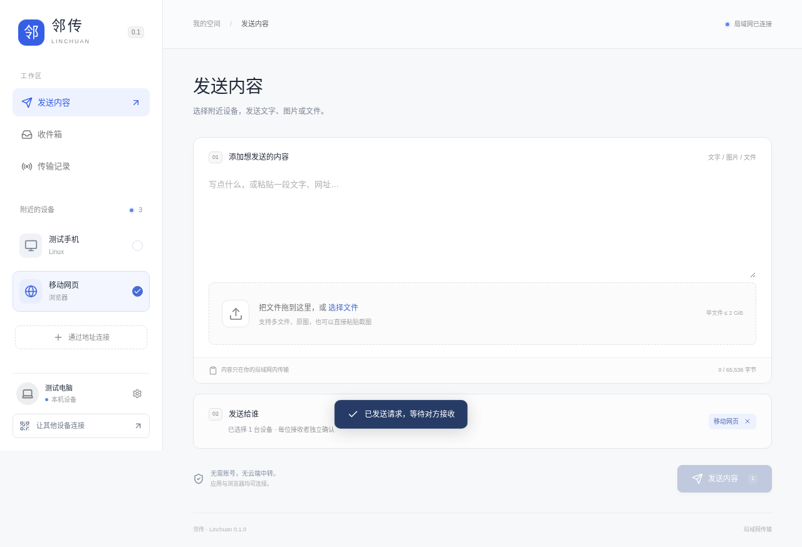

# 邻传 · Linchuan

**同一网络，随手互传。**

当前正式版为 **0.2.0**：三列会话界面、群聊和 SQLite 历史存储。支持从 0.1.0 覆盖升级，原有设备 ID 和名称自动迁移。

支持 Android、Linux、Windows 的局域网文字、图片与文件传送工具。应用间直接互传；未安装应用的设备可通过浏览器打开对方地址，配对后双向收发。每台应用使用系统分配的可用端口，无需独立服务器。

[下载 v0.2.0](https://github.com/whoarei/linchuan/releases/tag/v0.2.0) · [产品方案](docs/product-plan.md) · [技术方案](docs/technical-plan.md) · [会话与群聊数据模型](docs/data-model.md) · [开发与发布](docs/development.md) · [0.2 验证范围](docs/validation-0.2.md)



## 使用

1. 在至少一台设备安装并打开邻传，确保设备连接同一局域网。
2. 从附近设备或会话列表打开设备；发现不到时点击添加，通过地址连接。
3. 浏览器通过地址或二维码进入，输入对方应用显示的配对码后加入。
4. 在会话底部发送文字、图片或文件；多人发送通过新建群聊完成，各成员确认加入。文件可以分别接收和下载。

0.2 的会话、群成员、文字草稿和附件记录保存到 SQLite，完整文件保存在应用目录，重启后继续保留。设置中可改名、查看配对码和清理文件缓存；清理保留历史卡片。单文件最大 2 GiB，每次最多 64 个文件，每群最多 16 位成员。应用和网页需保持运行；群聊不自动补发离线消息。

## 平台

| 平台 | 安装产物 |
| --- | --- |
| Android 7.0+ | arm64 APK，发布签名 |
| Linux x86_64 | DEB / AppImage，Ubuntu 22.04+ 或兼容发行版 |
| Windows 10/11 x64 | NSIS 安装包，需要 WebView2 |
| 浏览器 | 现代 Chrome / Edge / Firefox / Safari，免安装连接运行中的应用 |

Linux AppImage 下载后先执行 `chmod +x Linchuan_0.2.0_amd64.AppImage`。如遇 FUSE 环境缺失，可使用 `./Linchuan*.AppImage --appimage-extract-and-run`。Windows 首次运行需要允许应用接收局域网连接。

## 当前边界

无账户、无云端、无外部 CDN。当前使用 **HTTP，未实现传输加密，仅用于可信局域网**。不提供公网穿透、断点续传或手机后台常驻保证。随机端口解决端口占用问题，不能绕过防火墙和路由器设备隔离。

Android/Windows 真机兼容性与真实 Wi-Fi 跨设备发现仍需持续验证；详见[本轮验证记录](docs/validation-0.2.md)。

## 开发

```bash
npm ci
npm run tauri dev
```

需要 Rust stable、Node.js 22 及对应平台的 Tauri 系统依赖。详见[开发文档](docs/development.md)。
