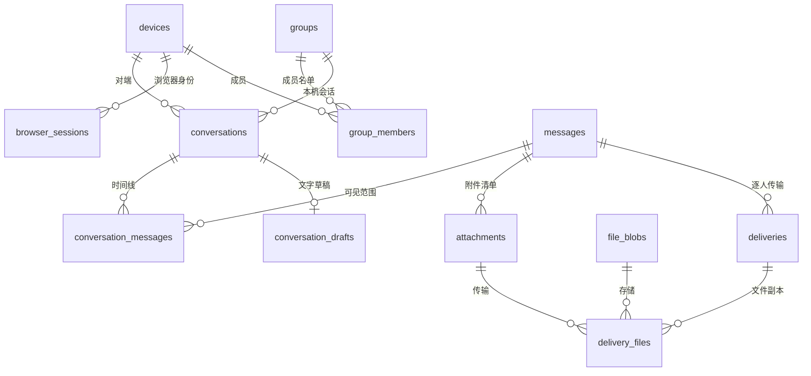

# 邻传数据模型

适用范围：0.2.0 会话式界面、群聊与本地持久化。本文初版先于实现单独提交；字段、约束及验收用例作为本次开发依据。0.1.0 的版本标签和安装包保持不变。

后续 schema 2 的接收目录设置、saved_files 表、保存队列和迁移规则见[固定接收目录与数据模型](receive-storage.md)。0.3.0 正式版仍使用 schema 1。

[浏览器临时会话与重连](browser-sessions.md)复用现有 browser_sessions、devices.kind 和会话草稿，无需新增数据库迁移；网页凭证在有效期内跨标签页复用，离线临时会话的历史默认收起。

## 1. 目标与边界

- 桌面采用功能栏、设备/群列表、消息与输入区三列布局；手机采用列表和会话两级页面，底部提供设备、设置、关于。
- 本机设置、已知设备、会话、群、成员、历史消息、附件元数据和每位接收者的结果保存到本机 SQLite，重启后可查看。
- 每台应用独立保存自己收到、发出的数据，不建设中心数据库。群成员之间直接发送，群主关闭应用不影响其余已加入成员互传。
- 群消息只面向当前已加入成员，在线收发；离线接收者显示未送达。暂不做离线排队、自动补发、跨设备历史补齐或新成员补历史。
- 本轮继续支持 Android、Linux、Windows、配对浏览器，采用灰白底色和蓝色强调色。HTTP 仍不提供内容保密性。

## 2. 存储约定

数据库为应用私有数据目录的 `linchuan.db`，附件放在同级 `files/`；文件二进制不进入 SQLite。草稿上传和 `.part` 文件位于运行期 staging 目录，不能在重启时清理已完成的持久附件。

SQLite 开启 foreign_keys、WAL、synchronous=FULL 和 busy_timeout。schema 迁移使用事务及 user_version；遇到高于程序支持的版本拒绝打开，不重建覆盖。数据库操作放到阻塞工作线程，不在网络/界面线程执行长时间磁盘操作。

数据库时间统一使用 UTC Unix 毫秒。旧协议中的秒时间字段在边界转换。标识使用 UUID 文本；名称、IP、端口不是身份。路径使用程序生成的目录和标识，原始文件名仅用于展示和另存。

## 3. 关系概览

一条群消息有一个全局 message_id 和多条 delivery。同一应用上的本机用户、配对浏览器可以通过不同的 conversation_messages 看到同一消息，各自的未读和权限独立。浏览器身份不能因为名称相同而合并。

## 4. 表定义

### 4.1 app_settings：本机设置

| 字段 | 类型/约束 | 用途 |
| --- | --- | --- |
| key | TEXT PRIMARY KEY | device_id、device_name、identity_secret 等 |
| value | TEXT NOT NULL | 对应值 |

首次升级从 0.1 的 device.json 迁移 device_id 和 device_name，保持身份与名称；后续以数据库为准。0.1 未落盘的内存历史无法恢复。

identity_secret 为本机签名私钥，仅存应用私有目录，不通过 API 返回、加入二维码或写入日志。其他本机浏览器身份由宿主应用代理签名，不向网页交付私钥。

### 4.2 devices：设备与浏览器身份

| 字段 | 类型/约束 | 用途 |
| --- | --- | --- |
| id | TEXT PRIMARY KEY | 稳定设备 ID 或独立 browser UUID |
| name | TEXT NOT NULL | 最近观察到的显示名称，1–64 字符 |
| platform | TEXT NOT NULL | Windows / Linux / Android / 浏览器 |
| kind | TEXT NOT NULL | app / browser / legacy |
| host_device_id | TEXT NOT NULL | 原生设备为自身；浏览器为宿主设备 |
| public_key | TEXT NULL | 宿主 Ed25519 公钥；旧版来源可为空 |
| last_address | TEXT NULL | 最近地址提示；不能据此认为在线 |
| created_at / updated_at / last_seen_at | INTEGER NOT NULL | 发现和更新记录 |

在线状态属于运行期观察，重启后一律重新探测；已知设备和离线会话保留。名称改变不会创建新身份。已固定的设备公钥发生变化时拒绝静默覆盖。

### 4.3 browser_sessions：配对凭证

| 字段 | 类型/约束 | 用途 |
| --- | --- | --- |
| token_hash | TEXT PRIMARY KEY | 随机 Bearer token 的 SHA-256，不存明文 |
| device_id | TEXT NOT NULL REFERENCES devices(id) | 该浏览器身份 |
| expires_at | INTEGER NOT NULL | 配对凭证期限 |
| last_seen_at | INTEGER NOT NULL | 活跃记录 |

owner token、配对码每次启动生成，不进入数据库。浏览器凭证在有效期内可恢复；随机端口改变导致网页 origin 改变时，浏览器原有存储不会自动跨 origin 迁移，不承诺仅凭设备名找回历史。过期凭证不授权读取旧身份数据。

### 4.4 groups：群资料

| 字段 | 类型/约束 | 用途 |
| --- | --- | --- |
| id | TEXT PRIMARY KEY | 全局群 UUID |
| name | TEXT NOT NULL | 群名，1–64 字符 |
| owner_id | TEXT NOT NULL REFERENCES devices(id) | 创建者身份 |
| revision | INTEGER NOT NULL CHECK(revision >= 1) | 创建者维护的资料版本 |
| snapshot_json | TEXT NOT NULL | 可验证的签名名单快照，作为协议证据 |
| created_at / updated_at | INTEGER NOT NULL | 时间 |

每群最多 16 位成员（含创建者）。群主只负责名单和资料管理，不是消息中转节点。群资料只接受创建者签名的更高版本；重复版本幂等，相同版本内容不一致拒绝。暂不提供群主转让。

### 4.5 group_members：名单、邀请及成员状态

| 字段 | 类型/约束 | 用途 |
| --- | --- | --- |
| group_id | TEXT REFERENCES groups(id) | 群 |
| device_id | TEXT REFERENCES devices(id) | 成员身份 |
| invite_id | TEXT NOT NULL | 本次邀请 UUID，防止旧事件重新加入 |
| role | TEXT NOT NULL | owner / member |
| state | TEXT NOT NULL | invited / joined / left |
| sequence | INTEGER NOT NULL | 该成员对本次邀请的决定序号 |
| event_json | TEXT NULL | 成员签名的加入/退出事件 |
| invited_at / joined_at / left_at | INTEGER / NULL | 生命周期 |

主键为 (group_id, device_id)。邀请由群主签名，接受/退出由成员所属宿主签名。未确认加入的设备不接收群消息。成员事件只更新自身状态，不能修改其他成员或名单；低序号、旧 invite_id 的事件不能覆盖新状态。发送方传播自己的已验证加入事件，以处理其他成员错过通知的情况。

### 4.6 conversations：每个本地身份的会话

| 字段 | 类型/约束 | 用途 |
| --- | --- | --- |
| id | TEXT PRIMARY KEY | 本地确定性 ID |
| principal_id | TEXT REFERENCES devices(id) | 能访问该会话的本地身份 |
| kind | TEXT NOT NULL | direct / group |
| peer_id | TEXT NULL REFERENCES devices(id) | 单设备对端 |
| group_id | TEXT NULL REFERENCES groups(id) | 群 |
| last_message_at / last_read_at | INTEGER NOT NULL | 摘要和未读计算 |
| created_at | INTEGER NOT NULL | 创建时间 |

direct 必须有 peer_id、没有 group_id；group 相反。唯一约束分别为 (principal_id, peer_id) 和 (principal_id, group_id)。选中附近设备可创建空会话。会话不因对方离线或文件清理而删除。历史名字保留在消息快照，列表名称取 devices 最新值。

### 4.7 messages：消息本体

| 字段 | 类型/约束 | 用途 |
| --- | --- | --- |
| id | TEXT PRIMARY KEY | 发送时生成一次，所有接收者共享 |
| sender_id | TEXT REFERENCES devices(id) | 发送身份 |
| sender_name | TEXT NOT NULL | 发送时名称快照 |
| group_id | TEXT NULL REFERENCES groups(id) | 群消息所属群 |
| text | TEXT NOT NULL | 文字正文，最多 64 KiB |
| created_at / received_at | INTEGER NOT NULL | 发送时间和本机收录时间 |

同一 message_id 重复到达不得创建重复气泡。若 sender、正文、群或附件清单不一致，拒绝复用。群消息包含发送者与 message_id 的签名，不能用显示名称决定发送身份。

### 4.8 conversation_messages：时间线和可见范围

| 字段 | 类型/约束 | 用途 |
| --- | --- | --- |
| position | INTEGER PRIMARY KEY AUTOINCREMENT | 本机分页游标 |
| conversation_id | TEXT REFERENCES conversations(id) | 会话 |
| message_id | TEXT REFERENCES messages(id) | 消息 |
| direction | TEXT NOT NULL | incoming / outgoing |
| read_at | INTEGER NULL | 此身份的已读记录 |

唯一约束 (conversation_id, message_id)。时间线按 position 排序，使用 before_position 游标加载更早记录；不依赖设备时钟大小或 offset 翻页。会话摘要、未读数通过本机视图计算，不表示对方“已读”。

### 4.9 attachments：附件声明

主键 (message_id, file_id)，外键 message_id → messages。字段：name TEXT、size INTEGER、mime TEXT、position INTEGER。单文件最多 2 GiB，每次最多 64 个，元数据与消息同时写入；不以用户文件名构造磁盘路径。

### 4.10 deliveries：每位接收者的传输结果

| 字段 | 类型/约束 | 用途 |
| --- | --- | --- |
| id | TEXT PRIMARY KEY | 本机传输 ID；双方可不同 |
| message_id | TEXT REFERENCES messages(id) | 对应消息 |
| recipient_id | TEXT REFERENCES devices(id) | 接收身份 |
| recipient_name | TEXT NOT NULL | 接收时名称快照 |
| status | TEXT NOT NULL | 见状态机 |
| bytes / total | INTEGER NOT NULL | 本机进度 |
| error | TEXT NULL | 可理解的失败原因 |
| incoming_remote | INTEGER NOT NULL | 是否为远端向本机提交 |
| created_at / updated_at | INTEGER NOT NULL | 生命周期 |

唯一约束 (message_id, recipient_id)。群 UI 聚合同一消息的 deliveries，明确展示已完成、等待、拒绝、失败人数；部分成功不能标为全员完成。离线成员写失败结果，不自动排队。

运行期传输 token、WebSocket、取消句柄、限流计数不落盘。数据库不承诺恢复 TCP 上传；启动时将上次 pending/accepted/transferring 置为 interrupted 并记录原因，绝不改成 completed。

### 4.11 file_blobs 与 delivery_files：文件副本

file_blobs：id TEXT PRIMARY KEY、relative_path TEXT UNIQUE、size INTEGER、state TEXT（available / missing / expired）、created_at INTEGER。

delivery_files：delivery_id REFERENCES deliveries、file_id TEXT、blob_id REFERENCES file_blobs、complete INTEGER；主键 (delivery_id, file_id)，附件由 delivery 对应 message_id 关联。

同一发送草稿向多人发送时复用同一源 blob；不同接收身份可以有自己的文件副本。磁盘配额按不同物理 blob 计算，不按接收者数量重复计算共享源文件。完成状态与文件可用状态独立：清理文件后保留消息和“已过期”卡片。

### 4.12 conversation_drafts：文字草稿

conversation_id TEXT PRIMARY KEY REFERENCES conversations、text TEXT、updated_at INTEGER。按会话保存文字草稿。浏览器 File 对象和未上传的文件选择不跨重启恢复；文件选择只在当前运行中保留。

## 5. 关键索引

- conversation_messages(conversation_id, position DESC)。
- conversations(principal_id, last_message_at DESC)。
- deliveries(message_id, recipient_id) UNIQUE、deliveries(status)。
- group_members(device_id, state)、groups(owner_id)。
- attachments(message_id, position)、delivery_files(blob_id)、browser_sessions(expires_at)。

## 6. 写入流程与一致性

### 单设备或群发送

校验会话权限及成员 → 上传文件到 staging → 将完整文件移到持久文件区 → 一个事务写消息、附件、会话可见关系和逐人 delivery → 提交成功后返回发送成功 → 对每个目标单独直传。文件系统与 SQLite 不是同一个事务，崩溃遗留的无引用文件由恢复清理处理，不能因此伪造已完成消息。

### 接收

验证协议、签名/来源及群成员资格 → 创建或幂等匹配消息 → 事务创建接收任务 → 用户确认文件接收 → `.part` 流式写入 → 大小一致后重命名 → 事务提交附件可用状态及 completed → 通知界面。已加入群的纯文字消息可以直接入库，文件仍独立确认；单设备接收沿用现有确认行为。

进度可以在内存中节流更新，状态转换与最终结果必须提交数据库。数据库失败不得返回持久化成功；内存状态应回滚，保留可解释错误。

## 7. 去中心化群协议与身份

基础直接传输协议保持兼容 0.1 的 protocol=1；通过 capabilities 识别 signed-offers-v1、groups-v1。新增字段包括稳定 message_id、sender_id、宿主身份、公钥及签名。群接口使用明确的群协议版本。

签名输入为 host_id、public_key、payload 组成的 JSON 对象：递归按键名字典序排序、数组顺序不变、UTF-8、紧凑无额外空白，避免原生构建依赖特性改变序列化结果。签名覆盖正文与附件清单等协议元数据，不覆盖文件二进制内容。

每个宿主拥有本机 Ed25519 密钥；签名绑定发送身份、宿主身份、目标身份、消息及群资料。群主签名单独定义邀请名单，成员签名单独定义自己的加入/退出，避免共享一个群口令就能替他人退群。首次邀请仍需人确认；未加密的 HTTP 和首次信任不能宣称防止所有局域网中间人攻击。

浏览器成员由宿主代理传输，退出宿主后暂不可达；其他原生成员仍可直接互传。群成员持久化名单，发送时按稳定 host_device_id 查找本次发现的随机端口，不能依赖创建群时的旧端口。

旧版无稳定发送身份的请求只作为兼容来源处理，不凭名称推断新设备身份，不能发送群消息。

## 8. 文件生命周期与重启恢复

- 完成附件默认保留，不因启动或 24 小时自动删除；设置提供清理文件缓存入口，历史正文和文件卡片保留。
- 10 GiB 本地预算包含持久文件及活动上传；空间不足时提示先清理。清理跳过正在上传、传输或引用中的文件。
- 启动时检查 schema、迁移设置、恢复已知设备/群/会话、将中断任务终结、核对附件是否存在、清理已失效的 staging。
- 过期浏览器凭证和临时下载 ticket 不授予历史读取权限。新启动的 owner token 与配对码继续随机生成。
- 会话和消息查询按已认证 principal_id 过滤；不能通过修改 conversation_id、message_id 或 file_id 访问他人的记录。

## 9. 本轮验收

1. 文档先提交；数据库 schema 与本文表、约束对应。
2. 升级后 device_id 和设备名不变；修改名称立即保存，其他设备重新发现/探测时更新。
3. 原生设备重启后，单聊/群聊文字、图片/文件记录、会话、群成员和文字草稿仍存在；离线会话可打开。
4. 当前进程未完成任务重启显示中断；已完成文件仍可下载；文件移除/清理后显示过期并保留历史。
5. 时间线分页无重复漏项，跨浏览器身份无法查看、确认、下载其他身份的数据。
6. 至少三个独立实例建群、确认邀请、群文字与文件直传；接收结果独立。关闭群主后其余已加入成员仍能发送。
7. 未加入、已退出、错误签名、冒用成员、过期邀请和重复消息不能绕过群权限或重复写入。
8. 桌面三列、手机列表/会话切换及设备/设置/关于可用；输入区支持文字、文件与图片。
9. 核心与浏览器自动化通过，并在 CI 检查 Android、Linux、Windows 构建。正式发布附安装产物、校验和及验证范围，0.1.0 保留可下载。
